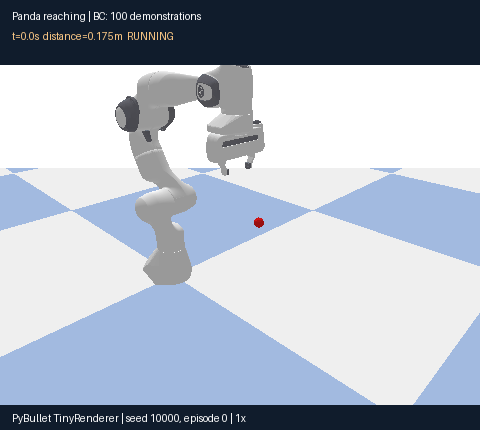
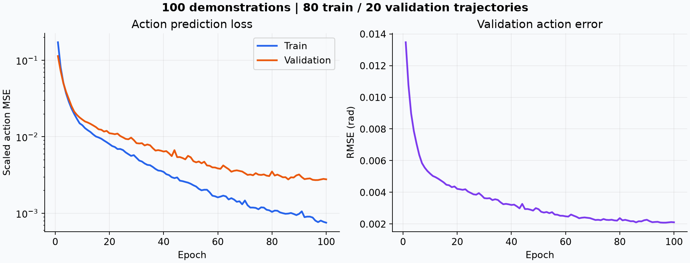
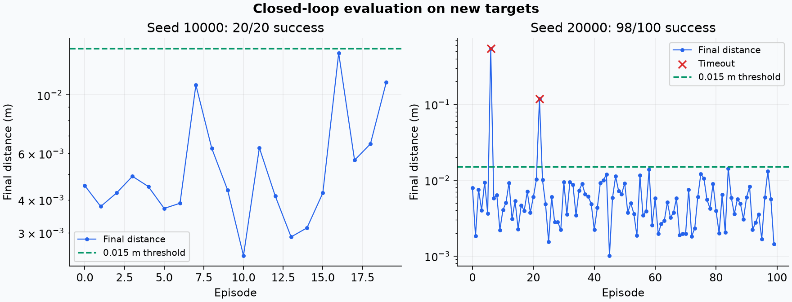

# PyBullet Panda 机械臂行为克隆

基于 PyBullet Franka Panda 的三维目标到达任务。项目包含采集、按轨迹划分数据、归一化、训练、模型保存、评估和可视化。

## 仿真效果



GIF 展示 seed=10000 的第一个测试目标，采用实际 PyBullet TinyRenderer 渲染，每帧间隔 0.1 秒，按仿真时间播放；成功后保持最后画面。红球表示目标，成功要求末端距离小于 0.015 m 连续 5 个控制步。GIF 使用 DIRECT 渲染。

## 实验结果

采集 seed=42，100 条专家示范全部成功，共 1832 帧。按轨迹划分为 80 条训练轨迹（1491 帧）和 20 条验证轨迹（341 帧）。训练 seed=0。

| 评估 | 目标数 | 成功数 | 成功率 |
|---|---:|---:|---:|
| seed=10000 | 20 | 20 | 100% |
| seed=20000 | 100 | 98 | 98% |

模型为 13→128→128→7 MLP，隐藏层使用 ReLU，输出层为线性层。训练使用 Adam、学习率 0.001、batch size 64、100 epoch，按验证 MSE 选择 best.pt。最佳验证动作 RMSE 约为 0.00211 rad。



曲线直接读取 `runs/bc_100/loss.csv`；左图为缩放动作的训练与验证 MSE，右图为验证动作 RMSE。



目标在 x∈[0.35,0.65]、y∈[−0.2,0.2]、z∈[0.25,0.55] m 内均匀采样，每条轨迹从固定 HOME 开始，最多 200 个控制步。独立测试中超时的 episode 为 6、22，目标和最终距离见 `results/eval_seed20000.json`。评估曲线使用对数纵轴，红色叉标记超时轨迹。

## 环境与运行

已运行环境为 Linux、Python 3.11、CPU Torch 2.15.0+cpu、NumPy 2.4.6、PyBullet 3.2.7。可视化依赖单独列在 `requirements_visual.txt`。

```bash
python3 -m venv .venv
.venv/bin/python -m pip install -r requirements_bc.txt
```

配套入口的默认路径已调整为本仓库数据与模型：训练读取 `data/expert100.npz`，输出到新的 `runs/bc_new`；评估默认读取 `runs/bc_100/best.pt`。`policy.py` 和 `learning.py` 保持原实现。

`run.sh` 总是选择仓库自己的 `.venv`，并切换到仓库目录。带 `--gui` 时自动应用已验证的系统图形库配置：

```bash
LD_PRELOAD=/usr/lib/x86_64-linux-gnu/libstdc++.so.6
LIBGL_DRIVERS_PATH=/usr/lib/x86_64-linux-gnu/dri
```

### 使用已训练模型

```bash
# 每次写入新的结果文件
bash run.sh evaluate_bc.py \
  --checkpoint runs/bc_100/best.pt --episodes 20 --seed 10000 \
  --output "runs/eval_$(date +%Y%m%d_%H%M%S)_$$.json"

# 桌面观察
bash run.sh evaluate_bc.py \
  --checkpoint runs/bc_100/best.pt --episodes 5 --seed 10000 --gui \
  --output "runs/gui_$(date +%Y%m%d_%H%M%S)_$$.json"
```

### 完整复现实验

```bash
bash scripts/reproduce.sh
```

脚本以 `mktemp` 新建实验目录，依次采集 100 条示范、训练 100 epoch、运行两组闭环评估，并在结束时打印目录。原数据和模型保持原文件。

单独训练现有的扩充数据：

```bash
bash run.sh train_bc.py --data data/expert100.npz \
  --run-dir "runs/retrain_$(date +%Y%m%d_%H%M%S)_$$"
```

### 重新生成图片与 GIF

```bash
.venv/bin/python -m pip install -r requirements_visual.txt
bash run.sh scripts/plot_results.py
bash run.sh scripts/render_demo.py \
  --output "assets/rollout_$(date +%Y%m%d_%H%M%S)_$$.gif"
```

曲线脚本更新两张固定名称的 PNG；GIF 脚本拒绝覆盖已有输出。两个脚本均读取仓库内的模型与结果。

## 接口与数据

| 项目 | 定义 |
|---|---|
| 观测 | `[q0…q6, ee_x, ee_y, ee_z, goal_x, goal_y, goal_z]`，13 维 |
| 动作 | 7 维关节角增量，单步限幅 ±0.04 rad |
| 末端 | Panda link 11，世界 link frame 位置 |
| 专家 | 当前 IK 解前 7 维减当前关节角，再限幅 |
| 执行 | POSITION_CONTROL，目标 q+action，forces=[87]×7 |
| 频率 | 物理 240 Hz，每个控制步执行 12 个物理步，控制 20 Hz |
| 训练输入 | 仅由训练轨迹计算 mean/std，std 下限 0.01 |
| 训练标签 | action / 0.04；评估乘回 checkpoint 的 action_scale |
| 保存 | best.pt、last.pt、config.json、loss.csv |

NPZ 字段包含 `observations`、`actions`、`next_observations`、`episode_id`、`episode_success`、`episode_end`。采集顺序为观察→专家标签→执行→下一帧观察。数据按完整轨迹划分，训练仅使用成功轨迹。

```text
.
├── collect_expert.py          # 专家与仿真公共接口
├── data_pipeline.py           # 数据划分与归一化
├── policy.py                  # 作者实现：网络与 forward
├── learning.py                # 作者实现：train_step
├── train_bc.py / evaluate_bc.py
├── data/                      # 100 条专家示范
├── runs/bc_100/               # 原版入口训练的扩充模型
├── results/                   # 两组新目标评估 JSON
├── assets/                    # 实际仿真 GIF 与数据曲线
├── scripts/                   # 复现、渲染和绘图脚本
└── requirements*.txt          # 运行与可视化依赖
```
